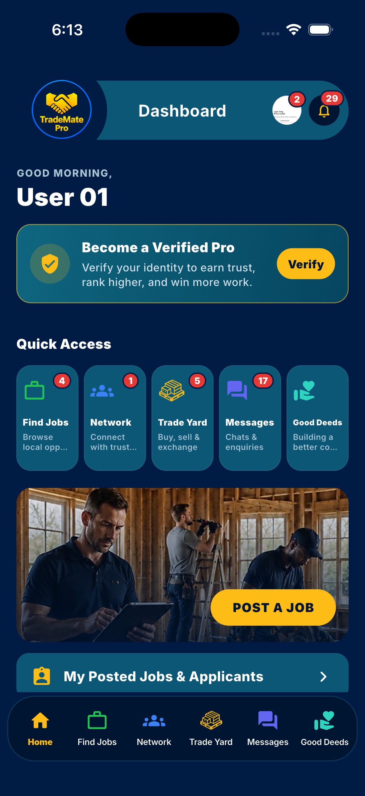
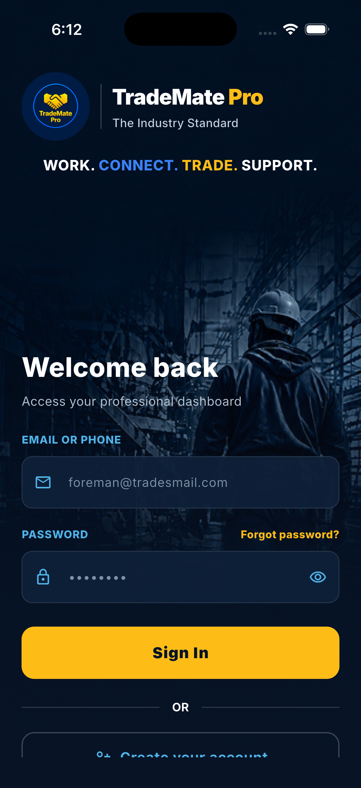
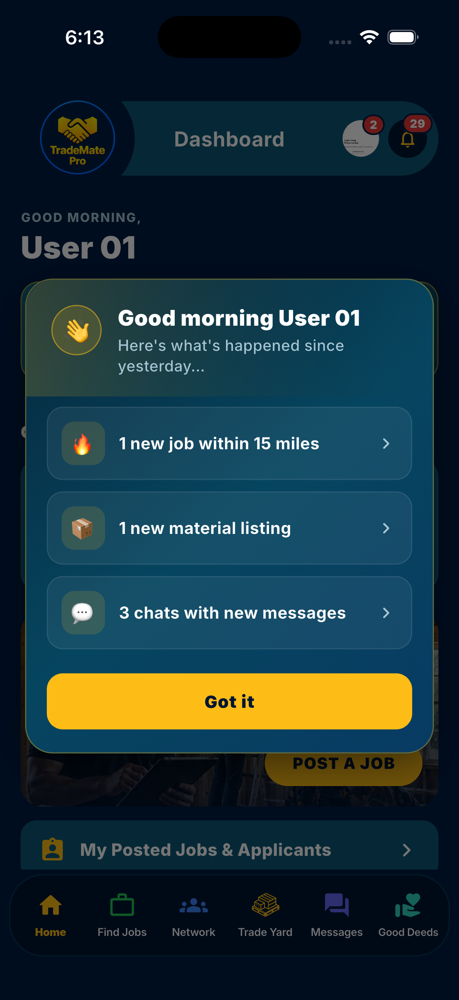
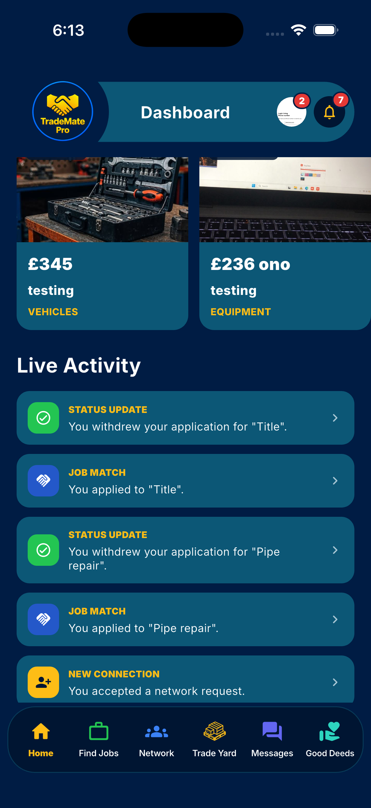

# TradeMate Pro

The industry standard app for UK trade professionals. TradeMate Pro is where trades find work, connect with each other, trade materials, and grow. Work. Connect. Trade. Support.

I built the mobile app end to end on React Native.

## What it does

- **Smart dashboard.** A live feed of job matches, application updates, new connections, and a daily summary of what changed.
- **Find jobs.** Browse and apply to local trade work.
- **Network.** Connect with trusted trades and grow a professional circle.
- **Trade Yard.** Buy, sell, and exchange tools, vehicles, and materials.
- **Messaging.** Chats and enquiries with other members.
- **Verified Pro.** Identity verification to earn trust, rank higher, and win more work.
- **Post a job.** Put work out to the network in minutes.

## Screenshots

  
  
  
  

## Built with

- React Native
- Real-time activity feed and notifications
- Secure auth and identity verification
- Marketplace and messaging

## Note

This is client work, so the source code is private. This page shows the product and my role on it.

Built by Hawa Yasir.

[LinkedIn](https://www.linkedin.com/in/hawa-yasir-6328b5255) and [GitHub](https://github.com/hawa-yasir)
